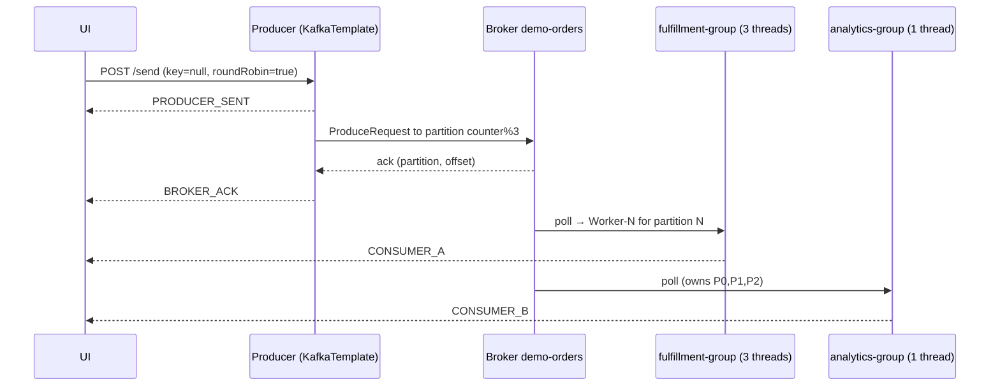
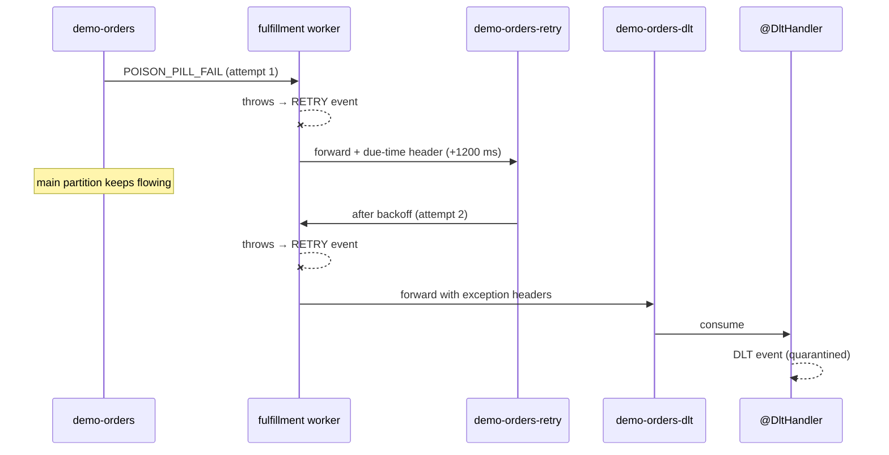

# Kafka Visual Lab

An interactive lab that shows how Apache Kafka moves a message from a producer, through a broker's partitions, to consumer groups. Each button in the UI runs one Kafka scenario against a real broker. The Spring Boot backend reports every step (send, broker ack, consume, retry, dead-letter, replay) to the browser over Server-Sent Events, and the React UI animates that step on a live topology diagram.

The lab covers four scenarios:

1. **Keyless partitioning**: spreading load across partitions
2. **Keyed partitioning**: per-key ordering through key hashing
3. **Poison pills**: non-blocking retries and a Dead Letter Topic (DLT)
4. **Offset replay**: rewinding consumer offsets to re-read the log

---

## Table of contents

- [Architecture](#architecture)
- [Quick start](#quick-start)
- [Kafka fundamentals used in this lab](#kafka-fundamentals-used-in-this-lab)
- [The topology in this lab](#the-topology-in-this-lab)
- [Scenario 1: Keyless messages and load distribution](#scenario-1-keyless-messages-and-load-distribution)
- [Scenario 2: Keyed messages and strict ordering](#scenario-2-keyed-messages-and-strict-ordering)
- [Scenario 3: Poison pills, retry topics and the DLT](#scenario-3-poison-pills-retry-topics-and-the-dlt)
- [Scenario 4: Offset replay](#scenario-4-offset-replay)
- [Live telemetry (SSE)](#live-telemetry-sse)
- [The UI](#the-ui)
- [REST API reference](#rest-api-reference)
- [Configuration reference](#configuration-reference)
- [Project layout](#project-layout)
- [Simplifications and caveats](#simplifications-and-caveats)
- [Troubleshooting](#troubleshooting)

---

## Architecture

```
┌────────────────────┐   POST /api/kafka/send     ┌──────────────────────────────────────────┐
│  React UI (Vite)   │ ─────────────────────────▶ │  Spring Boot backend (:8080)             │
│  localhost:3000    │   POST /api/kafka/replay   │                                          │
│                    │                            │  KafkaTemplate ──produce──┐              │
│  EventSource       │ ◀───────────────────────── │                           ▼              │
│  (kafka-trace)     │   GET /api/kafka/stream    │  ┌─────────────────────────────────────┐ │
└────────────────────┘   (Server-Sent Events)     │  │ Kafka broker (KRaft, :9092/:29092)  │ │
                                                  │  │  demo-orders        P0 P1 P2        │ │
                                                  │  │  demo-orders-retry  P0 P1 P2        │ │
                                                  │  │  demo-orders-dlt    P0 P1 P2        │ │
                                                  │  └─────────────────────────────────────┘ │
                                                  │      │ poll            │ poll            │
                                                  │      ▼                 ▼                 │
                                                  │  fulfillment-group  analytics-group      │
                                                  │  (3 threads,        (1 thread)           │
                                                  │   retry + DLT)                           │
                                                  │                                          │
                                                  │  TelemetryService ──▶ SSE emitters       │
                                                  └──────────────────────────────────────────┘
```

| Component | Tech | Role |
|---|---|---|
| `kafka` | `apache/kafka:3.8.0` | One Kafka node in **KRaft** mode, acting as both broker and controller. No ZooKeeper. |
| `kafka-init` | `apache/kafka:3.8.0` | One-shot container that creates the three topics with 3 partitions each, then exits. |
| `backend` | Java 21, Spring Boot 3.3, Spring Kafka | Producer, two consumer groups, retry and DLT handling, offset replay, SSE telemetry. |
| `frontend` | React 18, Vite 5 | Control buttons, animated topology, live telemetry log. |

---

## Quick start

### With Docker Compose (recommended)

```bash
docker compose up --build
```

Then open **http://localhost:3000**.

Compose starts the services in order:
1. `kafka` starts and is marked healthy once `kafka-topics.sh --list` succeeds.
2. `kafka-init` creates `demo-orders`, `demo-orders-retry` and `demo-orders-dlt`, each with 3 partitions and replication factor 1.
3. `backend` starts after `kafka-init` has exited successfully.
4. `frontend` starts after `backend`.

Stop the stack with `docker compose down`. Kafka data is not stored on a volume, so `down` deletes every topic and message.

### Running the apps locally (for development)

```bash
# 1. Start only the broker and create the topics
docker compose up kafka kafka-init

# 2. Backend: connects to localhost:9092 by default (needs JDK 21 + Maven)
cd backend
mvn spring-boot:run

# 3. Frontend
cd frontend
npm install
npm run dev        # http://localhost:3000
```

The UI calls the relative path `/api/kafka`. In local dev, Vite proxies it to `http://localhost:8080` (override with `API_PROXY_TARGET`). In Docker, the frontend is a minified production build served by nginx, which proxies `/api` to the backend.

`./pipeline-run.sh` deploys the stack behind the Cloudflare tunnel. It pulls the latest code, removes **all** Docker containers on the host, starts the tunnel (needs `TUNNEL_TOKEN` set globally, e.g. in `/etc/environment`) and runs `docker compose up -d --build`. The frontend container is named `rixus-frontend` on the `tunnel-net` network to match the tunnel's route.

---

## Kafka fundamentals used in this lab

If you already know Kafka, skip this section. Every scenario below builds on these terms.

| Concept | What it means |
|---|---|
| **Broker** | A Kafka server. It stores data and serves producers and consumers. This lab runs one broker. |
| **KRaft controller** | The component that manages cluster metadata (topics, partitions, leaders). Kafka uses its own Raft quorum for this instead of ZooKeeper. Here the single node runs both roles (`KAFKA_PROCESS_ROLES: broker,controller`). |
| **Topic** | A named stream of records, for example `demo-orders`. |
| **Partition** | A topic is split into partitions. Each partition is an **ordered, append-only log** stored on the broker's disk. Partitions are Kafka's unit of parallelism and of ordering. |
| **Offset** | The position of a record within one partition (0, 1, 2, …). Offsets only grow and each partition counts them separately, so P0 and P1 can both have an offset #4. |
| **Record key** | Optional. If present, it decides which partition the record goes to. |
| **Producer** | A client that sends records. Here that is Spring's `KafkaTemplate<String, String>`. |
| **acks** | How many replicas must confirm a write before the broker acks it. `acks=all` waits for all in-sync replicas. |
| **Idempotent producer** | The broker removes duplicates caused by producer retries, using a producer ID and sequence numbers. Each record is written exactly once per partition. |
| **Consumer group** | A set of consumers that share a `group.id`. Each partition is assigned to **exactly one** consumer in the group, so the members split the work. |
| **Committed offset** | Each group stores, per partition, the offset it has processed up to. Groups store these separately, so several groups can read the same topic at their own pace. |
| **Rebalance** | When consumers join or leave a group, the group coordinator reassigns partitions among the members. |
| **Retention** | Kafka keeps records for a configured time or size, **whether or not they were consumed**. Consuming does not delete anything. |

---

## The topology in this lab

### Topics

| Topic | Partitions | Purpose |
|---|---|---|
| `demo-orders` | 3 | The main topic. Every button produces to it. |
| `demo-orders-retry` | 3 | Holds failed records while they wait for a retry attempt. |
| `demo-orders-dlt` | 3 | Dead Letter Topic. Records that failed every attempt end up here. |

The retry topic and the DLT need the **same number of partitions** as the main topic. Spring Kafka forwards a failed record to the same partition number it came from, so a record from P2 must have a P2 to land in.

All three topics are created in three places, and each one does nothing if the topic already exists: by `kafka-init` in `docker-compose.yml`, by the `NewTopic` bean in `KafkaConfig` (for `demo-orders`), and by `@RetryableTopic(numPartitions = "3")` (for the retry topic and the DLT).

### Consumer groups

Two consumer groups subscribe to `demo-orders`:

| Group | Listener id | Concurrency | Simulated work | Behaviour |
|---|---|---|---|---|
| `fulfillment-group` | `fulfillment-listener` | 3 | 600 ms per record | Competing consumers. Each of the 3 threads owns one partition. Has retry and DLT handling. Fails on purpose for payloads containing `POISON` or `FAIL`. |
| `analytics-group` | `analytics-listener` | 1 | 900 ms per record | One consumer owns all three partitions. Never fails. |

Because they are **different groups**, each one gets **every** record. This is publish/subscribe fan-out. Inside `fulfillment-group`, the three threads split the partitions between them. This is the competing-consumers (queue) pattern. Kafka gives you both patterns from the same topic, and the only thing that picks between them is the group id.

The `Thread.sleep` calls exist only to slow processing down so you can follow the animation.

### Correlation IDs

When the backend sends a message, it creates an 8-character correlation ID and adds it to the front of the value: `a1b2c3d4|Order-Event #1`. Each listener splits the ID back off, so all telemetry events for one message (send → ack → consume → retry → DLT) share that ID.

---

## Scenario 1: Keyless messages and load distribution

**Button:** `1. Send Keyless Message (Round-Robin P0→P1→P2)`
**Request:** `POST /api/kafka/send?key=&payload=Order-Event #N&roundRobin=true`

### What happens

1. **`PRODUCER_SENT`**: The backend records that it is producing a record with a `null` key.
2. Because the key is null and `roundRobin=true`, the backend picks the partition itself: `counter++ % 3`. It then calls `kafkaTemplate.send(topic, partition, null, value)`. Clicks therefore go to P0, P1, P2, P0, …
3. The broker appends the record to the end of that partition's log and gives it the next offset.
4. **`BROKER_ACK`**: The send future completes with `RecordMetadata`, which holds the topic, partition and offset. The UI adds a cell to that partition's strip.
5. **`CONSUMER_A`**: The `fulfillment-group` thread that owns that partition receives the record.
6. **`CONSUMER_B`**: The single `analytics-group` consumer receives its own copy of the record.



### How Kafka handles this

- **Without the lab's round-robin override**, a null-key record is placed by Kafka's built-in partitioner. Since Kafka 2.4 this is the *sticky* partitioner, and since 3.3 the *uniform sticky* one. It does **not** rotate per record. It keeps filling a batch for one partition until the batch is full (`batch.size`) or sent (`linger.ms`), then moves to another partition. Large batches mean fewer requests and better throughput. With one click at a time, though, you would usually see several records in a row land on the same partition. The lab picks the partition explicitly so the spread is easy to see.
- To try the real sticky behaviour, call the API with no key and `roundRobin=false`:
  `curl -X POST "http://localhost:8080/api/kafka/send?payload=sticky-test&roundRobin=false"`
- **Why distribute at all?** Within a consumer group, one partition is read by only one consumer. Spreading records across P0–P2 lets all three `fulfillment-group` threads work at the same time. **The number of partitions caps the parallelism of a consumer group.** A fourth thread would have no partition and would sit idle.
- **The trade-off:** with no key, there is **no ordering guarantee** between records, because they sit in different partitions and are processed by different threads.

---

## Scenario 2: Keyed messages and strict ordering

**Buttons:** `2A. Send Keyed Message (key="USER-101")` and `2B. Send Keyed Message (key="USER-202")`
**Request:** `POST /api/kafka/send?key=USER-101&payload=User101-Checkout #N&roundRobin=false`

### What happens

1. **`PRODUCER_SENT`**: The producer serializes the key with `StringSerializer`.
2. Kafka's default partitioner computes:
   ```
   partition = toPositive(murmur2(keyBytes)) % numPartitions
   ```
   The hash only depends on the key bytes, so `USER-101` **always** maps to the same partition, and `USER-202` always maps to its own (possibly different) partition.
3. **`BROKER_ACK`**: The record is appended to that partition. Click 2A several times and every cell appears in the same strip, with offsets going up by one.
4. **`CONSUMER_A` / `CONSUMER_B`**: Both groups receive the record. In `fulfillment-group` it is always the same worker thread, the one that owns that partition.

### How Kafka handles this

- **Kafka guarantees order only within one partition, not across a whole topic.** A consumer reads a partition in offset order, one record at a time. So if every event for one entity goes to one partition, that entity's events are processed in the order they were produced. This is the standard way to order events per customer, account or aggregate.
- **Partition affinity also gives you thread affinity.** Inside a group, only one consumer owns that partition, so all `USER-101` events are handled one after another by the same thread. You don't need locks to guard against two threads handling the same user at once.
- **Idempotence protects ordering when the producer retries.** With `enable.idempotence=true`, a resent batch cannot be written twice or out of sequence, even with several in-flight requests. Without it, a retry after a timeout could reorder records or duplicate them.
- **Watch out for changing the partition count.** The mapping depends on `% numPartitions`. Adding partitions to a topic changes where existing keys map, which breaks ordering for keys that were already in flight. Choose the partition count up front for keyed topics.
- **Hot keys:** if one key produces most of the traffic, its partition, and the one consumer that owns it, becomes a bottleneck. Ordering per key rules out spreading that key across partitions.

---

## Scenario 3: Poison pills, retry topics and the DLT

**Button:** `3. Send Poison Pill (Retry → Dead Letter Topic)`
**Request:** `POST /api/kafka/send?key=BAD-TX&payload=POISON_PILL_FAIL #N&roundRobin=false`

A *poison pill* is a record that a consumer can never process, for example malformed data or a bug that is triggered by one specific payload. In this lab, any payload containing `POISON` or `FAIL` makes the `fulfillment-group` listener throw an exception.

### Why it needs special handling

A consumer reads a partition in order and commits offsets in order. If a listener simply retries a bad record forever, the partition is stuck at that offset, and every good record behind it waits. This is called **head-of-line blocking**. Skipping the record silently loses data. The usual fix is to move the failure **out of the main partition**, retry it somewhere else, and finally park it in a Dead Letter Topic where someone can inspect it.

### The configuration

```java
@RetryableTopic(
    attempts = "2",                       // the first try + 1 retry
    backoff = @Backoff(delay = 1200),     // wait 1.2 s before the retry
    numPartitions = "3",
    sameIntervalTopicReuseStrategy = SameIntervalTopicReuseStrategy.SINGLE_TOPIC,
    dltTopicSuffix = "-dlt"
)
@KafkaListener(id = "fulfillment-listener", topics = "demo-orders",
               groupId = "fulfillment-group", concurrency = "3")
```

A fixed backoff combined with `SINGLE_TOPIC` gives one retry topic, `demo-orders-retry`. With exponential backoff you would get one topic per delay instead (`-retry-0`, `-retry-1`, …).

### What happens, step by step

1. **`PRODUCER_SENT` → `BROKER_ACK`**: The poison pill is stored in `demo-orders` like any other record. Kafka does not inspect payloads. The key `BAD-TX` always hashes to the same partition.
2. **`CONSUMER_B`**: `analytics-group` processes the record **without any problem**. Its code doesn't check for poison, and each group's failures are its own.
3. **`RETRY` (attempt 1, topic `demo-orders`)**: The `fulfillment-group` worker throws `IllegalArgumentException`. Spring Kafka's error handler does **not** block the partition. It:
   - publishes the record to `demo-orders-retry`, on the same partition number, with headers that record the attempt count, the exception and a *due timestamp* (now + 1200 ms);
   - commits the original offset in `demo-orders`, so the next records in that partition carry on right away.
4. The retry topic's listener container (created automatically, also in `fulfillment-group`) receives the record. If it is not due yet, the container **pauses that retry partition** and comes back after the backoff. Waiting on the retry topic does not delay the main topic.
5. **`RETRY` (attempt 2, topic `demo-orders-retry`)**: The same listener method runs again and fails again. In the telemetry log this second `RETRY` line shows topic `demo-orders-retry`.
6. Both attempts have now failed, so the record is published to **`demo-orders-dlt`**. Spring adds headers with the exception class, the message, the stack trace and the original topic, partition and offset.
7. **`DLT`**: The `@DltHandler` method consumes the record from the DLT and reads the `kafka_dlt-exception-message` header. The UI adds a red cell to the `demo-orders-dlt` strip.



### How Kafka handles this

- Kafka itself knows nothing about retries or DLTs. A retry topic and a DLT are **ordinary topics**, and "retrying" just means producing the record again to another topic. Spring Kafka builds the pattern from the normal parts: producing, consuming, headers, pausing partitions and committing offsets.
- **The cost of non-blocking retries is ordering.** Once a record moves to the retry topic, records after it in the main partition are processed **before** it. If strict per-key order matters more than throughput, use blocking retries instead (`DefaultErrorHandler` with a `BackOff`). They stall the partition but keep the order.
- The DLT is durable and has a retention period like any other topic. You can inspect it, alert on it, or replay it once the bug is fixed.

---

## Scenario 4: Offset replay

**Button:** `4. Replay All Offsets from 0 (Seek to Beginning)`
**Request:** `POST /api/kafka/replay`

### What happens

1. **`REPLAY_TRIGGERED`**: The backend records the replay request.
2. `KafkaDemoService` implements `ConsumerSeekAware`. Spring calls it whenever a listener consumer gets or loses partitions, and the service keeps a map of *seek callback → assigned partitions* for each consumer.
3. On replay, the service picks only the `demo-orders` partitions (it skips the retry topic and the DLT, which the same bean also listens to). It then calls `callback.seekToBeginning(...)` for each consumer, in **both** `fulfillment-group` and `analytics-group`.
4. The seek runs on each consumer's own thread before its next poll, because `KafkaConsumer` is not thread-safe. Each consumer's position moves back to the start of the log.
5. Both groups then re-read every record still in `demo-orders`. You see a new burst of `CONSUMER_A` and `CONSUMER_B` events, in offset order within each partition.

### How Kafka handles this

- **Consuming a record does not delete it.** Classic queues such as RabbitMQ or SQS remove a message once it is acknowledged. Kafka keeps records until **retention** removes them (by time or size), no matter who has read them. A consumer's progress is just a number per partition, its **offset**.
- So replaying is just moving that number back. The broker does nothing special. The consumer fetches from an earlier position, and the next commit stores the new position for the group.
- `seekToBeginning` moves to the partition's **log-start offset**. On a fresh lab that is 0. In a real cluster where retention has deleted old segments, it is the oldest offset still kept. You can also seek to a specific offset or to a timestamp (`offsetsForTimes`).
- Each group seeks only its own position. Replaying one group does not affect any other group reading the same topic.
- Replay is how Kafka supports rebuilding a read model, backfilling a new service, or reprocessing after a bug fix.

### Things to notice

- Replayed records do **not** produce `BROKER_ACK` events, because nothing new is written. The partition strips stay the same, and only the consumer cards and the log light up.
- Replayed poison pills **fail again** in `fulfillment-group`. They go through the retry topic once more and are written to the DLT a second time. This shows that replay re-runs your processing logic, side effects included, so consumers should be **idempotent**.
- `auto-offset-reset: earliest` is the setting for when a group has **no committed offset** at all, for example a brand-new group. Such a group starts at the beginning. An explicit seek ignores this setting.

---

## Live telemetry (SSE)

`TelemetryService` keeps a list of `SseEmitter`s, one per open browser tab, with no timeout. Every stage of every scenario calls `telemetry.emit(TraceEvent)`, which sends a `kafka-trace` event to all connected clients. If an emitter fails because the client went away, it is removed from the list.

### `TraceEvent` fields

| Field | Description |
|---|---|
| `correlationId` | 8-character ID shared by all events for one message (`REPLAY-xxxx` for replays). |
| `stage` | One of the stages below. |
| `topic` | The topic involved (`demo-orders`, `demo-orders-retry`, `demo-orders-dlt`). |
| `key` | The record key (`null` for keyless records). |
| `payload` | The payload without the correlation ID. |
| `partition`, `offset` | Where the record is stored (`null` for `PRODUCER_SENT`, before the broker assigns them). |
| `consumerGroup` | The consumer group that handled the record, if any. |
| `consumerThread` | A logical worker name, for example `Fulfillment-Worker-2`. |
| `description` | A plain-English explanation shown in the log. |
| `timestamp` | Epoch milliseconds. |

### Stages

| Stage | Emitted when | Scenario |
|---|---|---|
| `PRODUCER_SENT` | Before `KafkaTemplate.send()` | All sends |
| `BROKER_ACK` | The send future completes with `RecordMetadata` | All sends |
| `CONSUMER_A` | `fulfillment-group` processes a record successfully | 1, 2, 4 |
| `CONSUMER_B` | `analytics-group` processes a record | 1, 2, 3, 4 |
| `RETRY` | `fulfillment-group` throws on a record (main topic or retry topic) | 3, 4 |
| `DLT` | `@DltHandler` receives a record whose attempts are used up | 3, 4 |
| `REPLAY_TRIGGERED` | `/replay` is called | 4 |

You can watch the raw stream without the UI:

```bash
curl -N http://localhost:8080/api/kafka/stream
```

---

## The UI

The page (`frontend/src/App.jsx`) opens one `EventSource` to `/api/kafka/stream` and updates its state on each `kafka-trace` event.

- **Control bar:** five buttons that run the scenarios above. Payloads are numbered with a counter in the browser (`Order-Event #1`, `#2`, …).
- **Lesson banner:** explains the concept behind the button you clicked last. It also shows the *in-flight packet* (key, payload, current stage) from the latest event.
- **Topology board:**
  - **Producer card:** glows on `PRODUCER_SENT` and shows the serializer, acks and partitioner settings.
  - **Broker card:** one strip per partition of `demo-orders`, showing the last 6 records appended (offset + key). The partition that just received an ack is highlighted. Below it, the `demo-orders-dlt` strip shows the last 5 quarantined records.
  - **Group A card:** three worker rows. The row that handled the latest event turns green on `CONSUMER_A` and red on `RETRY`.
  - **Group B card:** one consumer that owns P0, P1 and P2.
  - **DLT handler card:** glows red on `DLT`.
  - The arrows between columns light up for producer/broker stages and for consumer stages.
- **Telemetry panel:** the 40 most recent events, newest first, colour-coded by stage.

UI state is kept only in the browser. Reloading the page clears the strips and the log, but the data in Kafka is still there. Use Replay to see it again.

---

## REST API reference

Base URL: `http://localhost:8080/api/kafka` (CORS allows all origins)

| Method | Path | Parameters | Response |
|---|---|---|---|
| `GET` | `/stream` | none | `text/event-stream` of `kafka-trace` events |
| `POST` | `/send` | `payload` (required), `key` (optional, blank = null), `roundRobin` (default `false`, only used when the key is null) | `{"status":"dispatched"}` |
| `POST` | `/replay` | none | `{"status":"replaying_from_offset_0"}` |

`/send` returns as soon as the record has been handed to the producer, before the broker acks it. The ack arrives later as a `BROKER_ACK` event.

Examples:

```bash
# keyed
curl -X POST "http://localhost:8080/api/kafka/send?key=USER-101&payload=hello"
# poison pill
curl -X POST "http://localhost:8080/api/kafka/send?key=BAD-TX&payload=POISON_test"
# replay
curl -X POST "http://localhost:8080/api/kafka/replay"
```

---

## Configuration reference

### Broker (`docker-compose.yml`)

| Setting | Value | Why |
|---|---|---|
| `KAFKA_PROCESS_ROLES` | `broker,controller` | One node runs KRaft in combined mode. |
| `KAFKA_LISTENERS` | `PLAINTEXT://:29092, CONTROLLER://:29093, PLAINTEXT_HOST://:9092` | Port 29092 is for other containers, 29093 for the controller quorum, 9092 for the host. |
| `KAFKA_ADVERTISED_LISTENERS` | `PLAINTEXT://kafka:29092, PLAINTEXT_HOST://localhost:9092` | The address the broker tells clients to use. Containers get `kafka:29092`, the host gets `localhost:9092`. A wrong advertised listener is the most common cause of "connects, then times out". |
| `KAFKA_CONTROLLER_QUORUM_VOTERS` | `1@kafka:29093` | A one-member Raft quorum. |
| `*_REPLICATION_FACTOR` / `*_MIN_ISR` | `1` | Internal topics (`__consumer_offsets`, transaction state) must fit on one broker. |
| `KAFKA_GROUP_INITIAL_REBALANCE_DELAY_MS` | `0` | Consumer groups form right away instead of waiting 3 s for more members. |

### Backend (`backend/src/main/resources/application.yml`)

| Setting | Value | Effect |
|---|---|---|
| `bootstrap-servers` | `${SPRING_KAFKA_BOOTSTRAP_SERVERS:localhost:9092}` | Compose sets `kafka:29092`. Local runs use `localhost:9092`. |
| `producer.acks` | `all` | Wait for all in-sync replicas. With replication factor 1, that means only the leader. |
| `producer.enable.idempotence` | `true` | Each record is written exactly once per partition, in order, even when the producer retries. |
| `key/value-serializer` | `StringSerializer` | Keys and values are plain strings. |
| `consumer.auto-offset-reset` | `earliest` | A group with no committed offsets starts at the beginning of each partition. |
| `key/value-deserializer` | `StringDeserializer` | Matches the serializers. |

Offsets are committed by Spring Kafka's listener container (the default `BATCH` ack mode) after the listener returns. So a record counts as consumed only after it was processed, or after it was handed to the retry topic.

---

## Project layout

```
.
├── docker-compose.yml          # Kafka (KRaft) + topic init + backend + frontend
├── backend/
│   ├── Dockerfile              # Maven build → JRE 21 runtime
│   ├── pom.xml                 # Spring Boot 3.3.4, spring-kafka
│   └── src/main/
│       ├── resources/application.yml
│       └── java/com/example/kafkalab/
│           ├── KafkaLabApplication.java      # @SpringBootApplication @EnableKafka
│           ├── config/KafkaConfig.java       # demo-orders NewTopic (3 partitions)
│           ├── controller/KafkaLabController.java  # /stream, /send, /replay
│           ├── model/TraceEvent.java         # telemetry record
│           └── service/
│               ├── KafkaDemoService.java     # producer, listeners, retry/DLT, replay
│               └── TelemetryService.java     # SSE fan-out
└── frontend/
    ├── Dockerfile              # Vite dev server on :3000
    ├── vite.config.js
    └── src/
        ├── App.jsx             # scenarios, topology, telemetry
        ├── App.css
        └── main.jsx
```

---

## Simplifications and caveats

This is a teaching lab, not a production template.

- **One broker, replication factor 1.** There is no failover, and `acks=all` is no stronger than `acks=1`. In production, use at least 3 brokers, replication factor 3 and `min.insync.replicas=2`.
- **Keyless round-robin is done by the app**, not by Kafka. See [Scenario 1](#scenario-1-keyless-messages-and-load-distribution) for the real sticky partitioner.
- **Worker names come from the partition number.** `Fulfillment-Worker-N` is the name of whichever thread handled partition N. With concurrency 3 and 3 partitions, each container thread owns one partition, so the names match one-to-one in steady state. The actual partition-to-thread assignment is decided by the group's assignor and can change after a rebalance.
- **Failure is simulated** by checking the payload text for `POISON` or `FAIL`.
- **No persistent volume.** `docker compose down` deletes all topics and messages.
- **No authentication or TLS.** The listeners use `PLAINTEXT` and CORS allows `*`.
- **The frontend runs the Vite dev server** inside its container. There is no production build.

---

## Troubleshooting

| Symptom | Likely cause / fix |
|---|---|
| The UI shows nothing when you click | Check that the backend is up (`curl -N localhost:8080/api/kafka/stream`) and look at the browser console for CORS or connection errors. |
| The backend logs `UNKNOWN_TOPIC_OR_PARTITION` or keeps reconnecting | The broker is not ready, or the topics are missing. Check `docker compose logs kafka-init`. |
| The backend runs locally but cannot reach Kafka | Make sure you use `localhost:9092`, and that the broker's advertised `PLAINTEXT_HOST` listener is `localhost:9092`. |
| A retry or DLT error mentions partitions | The retry topic and the DLT must have the same partition count as `demo-orders` (3). |
| List topics or describe groups from the CLI | `docker exec -it kafka-broker /opt/kafka/bin/kafka-topics.sh --bootstrap-server localhost:9092 --describe` · `docker exec -it kafka-broker /opt/kafka/bin/kafka-consumer-groups.sh --bootstrap-server localhost:9092 --describe --all-groups` |
| Read the DLT directly | `docker exec -it kafka-broker /opt/kafka/bin/kafka-console-consumer.sh --bootstrap-server localhost:9092 --topic demo-orders-dlt --from-beginning --property print.headers=true` |
